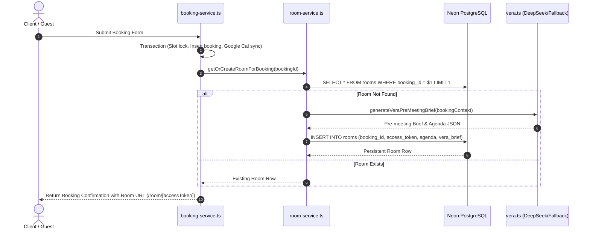
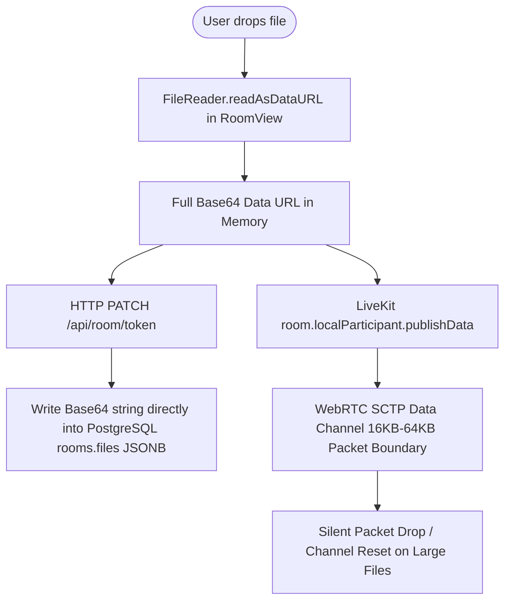
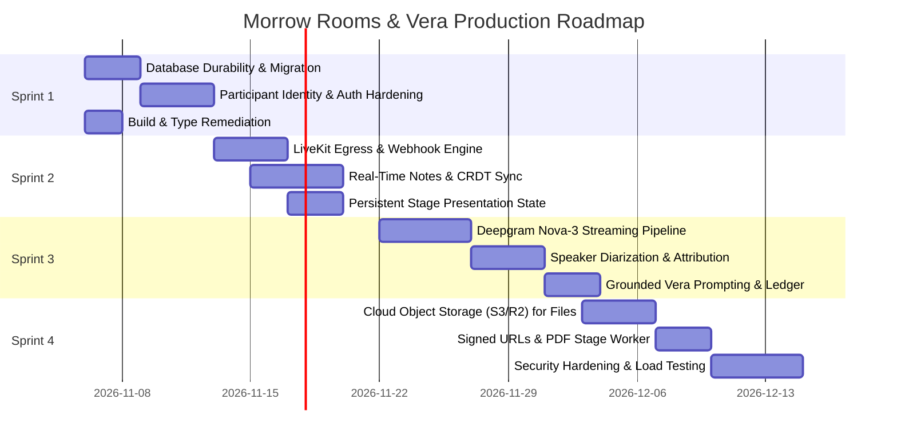

# Morrow Rooms & Vera AI Scribe: Production Readiness Engineering Audit

**Audit Date:** November 5, 2026  
**Auditor:** Principal Infrastructure & Real-Time Systems Pair Architect (Sprint 0 Audit)  
**Target Repository:** `https://github.com/EmmyCodes234/morrow-scheduler.git`  
**Inspected Branch:** `fix/booking-engine-integrity`  
**HEAD Commit:** `2ac43e0913454b753e31a2f62cdbd875c142d888`  
**Delivery Scope:** Audit Only — Zero production code refactored, zero schema changes, zero API credits expended.

---

## 1. Executive Summary & Production Readiness Scorecard

Morrow Rooms and Vera (Morrow's AI Scribe) represent a strategically powerful vision: elevating a standard calendar scheduling workflow into a continuous collaborative workspace before, during, and after meetings.

However, an exhaustive engineering audit of the codebase reveals that **Morrow Rooms and Vera are NOT currently ready for production deployment**. 

While the user interface visually presents a polished, high-fidelity experience conforming to BoardUI standards, the underlying real-time architecture, data persistence layers, security boundaries, and AI grounding mechanisms suffer from foundational gaps that will cause severe failures, security breaches, and data corruption under real-world usage.

### Production Readiness Scorecard

| Subsystem | Readiness Score | Production Status | Primary Blocker / Failure Mode |
| :--- | :---: | :---: | :--- |
| **Participant Identity & Access Control** | **15 / 100** | 🛑 **P0 Blocker** | Universal identity spoofing: all participants connect as Host (`room.booking.host.name`); unauthenticated room state mutation. |
| **Document Storage & Stage Presentation** | **20 / 100** | 🛑 **P0 Blocker** | In-database Base64 file storage in JSONB; broadcasting megabyte payloads over WebRTC Data Channel breaks SCTP limits; missing migration. |
| **Room Provisioning & Database Durability** | **35 / 100** | ⚠️ **P1 Critical** | Lack of unique constraint on `rooms.booking_id` allows race conditions and duplicate rooms; missing Drizzle migration for `rooms.files`. |
| **Vera AI Scribe & Grounding Engine** | **30 / 100** | ⚠️ **P1 Critical** | Zero audio transcription; post-meeting ledger is ungrounded and fabricates decisions/actions from sparse notes. |
| **Real-Time Collaboration & Synchrony** | **40 / 100** | ⚠️ **P1 Critical** | Notes only save via debounced HTTP (1200ms) with no live data channel broadcast; concurrent typing causes silent data loss. |
| **LiveKit WebRTC Media Integration** | **70 / 100** | 🟡 **P2 Major** | Camera/mic/screenshare work, but 6-hour token TTL is excessive; no server-side egress or webhook reconciliation. |
| **Build & Type Integrity** | **65 / 100** | ⚠️ **P1 Critical** | Production build fails type check (`Avatar size="2xs"` in `components/room/room-view.tsx:1464` violates BoardUI `AvatarSize`). |
| **Overall Composite Readiness** | **38 / 100** | 🛑 **BLOCKED** | **Requires multi-sprint remediation before public traffic onboarding.** |

---

## 2. Repository and Git Preflight Verification

The preflight inspection confirmed the exact repository context:

- **Working Directory:** `C:\easy-model`
- **Repository Remote:** `https://github.com/EmmyCodes234/morrow-scheduler.git` (verified as `origin`)
- **Current Branch:** `fix/booking-engine-integrity`
- **Upstream Tracking:** `origin/fix/booking-engine-integrity` (fully synchronized, up to date)
- **HEAD Commit:** `2ac43e0913454b753e31a2f62cdbd875c142d888`
- **Working Tree State:** Clean; zero untracked, staged, or uncommitted files prior to this audit report.
- **Recent Commit Context:**
  - `2ac43e0` — `fix(booking): eliminate slot conflicts and ensure zero-drift Google Calendar sync`
  - `4667d59` — `docs(audit): update competitive parity audit with phase 1.3 calendar integration results`
  - `f24db68` — `fix(scheduling): lock slot before gcal sync to prevent booking races`
  - `89b18a3` — `test(scheduling): verify slot locking prevents duplicate bookings`
  - `c06254c` — `fix(scheduling): prevent duplicate bookings for same slot`

---

## 3. Morrow Rooms Architectural Deep-Dive

### A. Room Provisioning Journey & Database Atomicity

The provisioning pipeline traces through:
`Booking Confirmation → processBooking() → getOrCreateRoomForBooking() → Room Persistence → Participant Access`



#### Code Inspection Findings:
1. **Lack of Unique Constraint on `rooms.bookingId`:**
   - In [`db/schema.ts:193`](file:///c:/easy-model/db/schema.ts#L193) and [`drizzle/0006_complete_wiccan.sql:17`](file:///c:/easy-model/drizzle/0006_complete_wiccan.sql#L17), `rooms.bookingId` has a standard B-tree index (`CREATE INDEX "rooms_booking_idx" ON "rooms" USING btree ("booking_id")`), but **no unique constraint**.
   - In [`lib/room/room-service.ts:40-75`](file:///c:/easy-model/lib/room/room-service.ts#L40-L75), `getOrCreateRoomForBooking` uses an application-level `findFirst` followed by `db.insert(rooms)`.
   - **Race Condition Vulnerability:** If concurrent booking requests or webhook retries trigger `getOrCreateRoomForBooking` simultaneously, both checks can see null and insert two separate rooms for the same booking, generating two different `accessToken`s. Subsequent queries return the first matched row, splintering room state between participants.
2. **Missing Drizzle Migration for `rooms.files`:**
   - In [`db/schema.ts:200`](file:///c:/easy-model/db/schema.ts#L200), `files: jsonb("files").default([]).notNull()` is defined.
   - However, [`drizzle/0006_complete_wiccan.sql`](file:///c:/easy-model/drizzle/0006_complete_wiccan.sql) does not contain `files`.
   - In [`drizzle/meta/_journal.json`](file:///c:/easy-model/drizzle/meta/_journal.json), `0006_complete_wiccan` is the latest entry; no `0007_*.sql` exists.
   - Any fresh deployment running `pnpm db:migrate` will create a table missing the `files` column, resulting in instant SQL exceptions on any room read or write.
3. **Rescheduling & Cancellation Lifecycle Behavior:**
   - **Rescheduling:** Rescheduling updates `bookings.startTime` and `bookings.endTime`. Because `rooms.bookingId` remains tied to `bookings.id`, the room and its historical notes/files are preserved. This is a positive architectural trait.
   - **Cancellation:** In [`lib/scheduling/cancellation-service.ts`](file:///c:/easy-model/lib/scheduling/cancellation-service.ts), cancelling a booking sets `bookings.status = 'cancelled'`. However, `rooms` records are **never updated or invalidated**.
   - In [`app/room/[token]/page.tsx`](file:///c:/easy-model/app/room/[token]/page.tsx) and [`app/api/room/[token]/livekit/route.ts`](file:///c:/easy-model/app/api/room/[token]/livekit/route.ts), there is **zero check for `room.booking.status`**. A participant possessing the room token of a cancelled or rejected meeting can still enter `/room/[token]`, mint LiveKit tokens, and conduct video calls.

---

### B. Room Access and Security Architecture

#### 1. Universal Participant Identity Spoofing (Severity: P0)
In [`components/room/room-view.tsx:200-203`](file:///c:/easy-model/components/room/room-view.tsx#L200-L203):
```typescript
const res = await fetch(`/api/room/${room.accessToken}/livekit`, {
  method: "POST",
  headers: { "Content-Type": "application/json" },
  body: JSON.stringify({
    participantName: room.booking.host.name,
    role: "host",
  }),
});
```
And in [`app/api/room/[token]/livekit/route.ts:21-32`](file:///c:/easy-model/app/api/room/[token]/livekit/route.ts#L21-L32):
```typescript
const body = await req.json().catch(() => ({}));
const { participantName, role } = body;

const token = await generateLivekitToken({
  roomName: room.id,
  participantIdentity: `${role || "guest"}-${Date.now()}-${Math.random().toString(36).substring(2, 7)}`,
  participantName: participantName || "Guest",
  role: role || "guest",
});
```
- **The Defect:** When a guest receives the meeting link and opens `/room/[token]`, the client component unconditionally claims:
  - `participantName = room.booking.host.name` ("Enyi Emmanuel")
  - `role = "host"`
- The API route trusts whatever `role` and `participantName` the client sends in the JSON body.
- **Consequence:** Both the Host and the Guest connect to LiveKit as "Enyi Emmanuel (Host)". In the UI, the guest sees themselves as the Host. Both participants have host publishing rights, can kick participants, or claim host ownership in LiveKit SFU.

#### 2. Unauthenticated State Mutation & Meeting Termination (Severity: P0)
In [`app/api/room/[token]/route.ts:25-78`](file:///c:/easy-model/app/api/room/[token]/route.ts#L25-L78):
- The `PATCH` handler allows anyone possessing the URL access token to:
  - Overwrite shared notes.
  - Check or uncheck agenda items.
  - Upload arbitrary files.
  - Trigger `action: "conclude"`.
- Possessing the URL alone gives unrestricted write access. A guest, an unintended recipient, or a scraper can prematurely conclude the meeting, which freezes the room state into `"concluded"` and immediately triggers post-meeting AI synthesis.

---

### C. In-Room Document Presentation & File Storage Architecture

The current document workflow represents a critical reliability and scalability hazard:



#### Code Inspection Findings:
1. **Base64 In-Database Storage:**
   - In [`components/room/room-view.tsx:325-358`](file:///c:/easy-model/components/room/room-view.tsx#L325-L358), files uploaded via drag-and-drop or file input are read into memory using `reader.readAsDataURL(file)`.
   - The entire Base64 payload is stored in PostgreSQL inside the `rooms.files` JSONB column.
   - Storing PDF decks (e.g., 5MB–15MB) in JSONB rapidly expands PostgreSQL storage, increases row read times from milliseconds to seconds, and will trigger HTTP 413 (Payload Too Large) in Next.js server actions / API routes which default to 4MB limits.
2. **WebRTC Data Channel Packet Overflow:**
   - Line 351 executes:
     `room.localParticipant.publishData(new TextEncoder().encode(JSON.stringify({ type: "FILE_ADDED", file: newFile })))`
   - WebRTC SCTP data channels generally limit individual message buffers to 16KB–64KB depending on browser implementation. Attempting to transmit a 500KB or 5MB Base64 file across `publishData` causes immediate buffer overflows, dropped messages, or abrupt data channel closures.
3. **Absence of Cloud Object Storage:**
   - There is no Amazon S3, Cloudflare R2, or Supabase/Neon Storage integration.
   - Files lack server-side MIME type validation, content verification, antivirus scanning, or time-limited signed download URLs.
4. **Stage Presentation Synchronization:**
   - Stage presentation is controlled via `activeFileId` state in React.
   - When a user clicks "Present on Stage", a message is emitted across the data channel (`{ type: "PRESENT_FILE", fileId }`).
   - If a participant joins late or reloads their page, they do not see what is on stage because stage presentation state is not persisted in the database.

---

### D. Shared Notes & Collaborative Synchronization

1. **Lack of Real-Time Broadcast:**
   - In [`components/room/room-view.tsx:282-315`](file:///c:/easy-model/components/room/room-view.tsx#L282-L315), typing in the "Shared Notes" textarea triggers an autosave debounced at 1,200ms:
     `PATCH /api/room/${token}` with `{ sharedNotes: value }`.
   - **Crucial Omission:** The note update is **never broadcasted over the LiveKit Data Channel**.
   - As a result, other participants in the meeting never see notes updating in real time. They only see notes if they manually reload the page.
2. **Concurrency Collisions (Last-Write-Wins):**
   - If both the Host and Guest take notes during the meeting, their debounced HTTP PATCH requests will continuously overwrite each other in PostgreSQL, resulting in silent, unrecoverable data loss.
   - There is no operational transformation (OT), conflict-free replicated data type (CRDT, e.g., Yjs), or collaborative locking mechanism.

---

## 4. LiveKit WebRTC Integration Assessment

### Token Minting & Grants
In [`lib/room/livekit-token.ts:40-58`](file:///c:/easy-model/lib/room/livekit-token.ts#L40-L58):
- Tokens are minted using `livekit-server-sdk`.
- `canPublish: true`, `canSubscribe: true`, `canPublishData: true` are granted to all participants.
- `ttl: "6h"` (6 hours) is configured. This duration is excessively long for a scheduled meeting (typically 30–60 minutes) and allows persistent access long after the session has finished.
- Secret handling is secure: credentials (`LIVEKIT_API_KEY`, `LIVEKIT_API_SECRET`, `LIVEKIT_URL`) are read exclusively on the server and are never exposed to the client.

### Connection & Disconnection Management
- In `components/room/room-view.tsx`, participant connection is tracked via LiveKit's `RoomEvent.ParticipantConnected` and `RoomEvent.ParticipantDisconnected`.
- **System Cannot Distinguish Lifecycle Events:**
  1. A participant temporarily refreshing their browser vs permanently leaving.
  2. LiveKit media session terminating vs the persistent Morrow Room concluding.
- If all participants leave the call, the room remains in status `"active"`. It is only marked `"concluded"` if someone manually clicks the "End Meeting" button.

### Webhook Reconciliation
- **Missing Webhook Handler:** There is no LiveKit webhook endpoint (`/api/webhooks/livekit`) configured in the repository.
- Without webhooks, if participants close their browser tabs without clicking "End Meeting", the room never learns that the meeting has ended, and Vera's post-meeting ledger is never generated.

---

## 5. Vera Intelligence Engine Assessment

Vera is implemented in [`lib/intelligence/vera.ts`](file:///c:/easy-model/lib/intelligence/vera.ts).

### Model Configuration & SDK Integration
- **API Endpoint:** `https://api.deepseek.com/chat/completions` (OpenAI-compatible fetch request).
- **Model Identifier:** Configured as `process.env.DEEPSEEK_MODEL || "deepseek-chat"` (DeepSeek-V3).
  - *Note:* Product documentation and marketing materials refer to "DeepSeek 4", but the actual configured model is `"deepseek-chat"`.
- **Resilience:** Requests have a 25,000ms timeout (`AbortSignal.timeout(25000)`). If DeepSeek fails, times out, or `DEEPSEEK_API_KEY` is omitted, Vera gracefully falls back to deterministic heuristic generation.

### Vera Capabilities Across the Meeting Lifecycle

| Phase | Vera Capability | Implementation Status | Grounding Source | Production Assessment |
| :--- | :--- | :---: | :--- | :--- |
| **Pre-Meeting** | Session Purpose, Suggested Agenda, Discussion Points | ✅ **Functional** | Booking metadata (Event type, Host, Guest, Notes) | Reliable; structured output conforms to schema with solid heuristic fallback. |
| **In-Meeting** | Real-time transcript tracking, mid-call nudges | ❌ **Non-Existent** | None | Not implemented. Vera has zero real-time audio or text stream during the call. |
| **Post-Meeting** | Executive Summary, Key Decisions, Action Items | ⚠️ **Hallucination Risk** | Shared Notes, Agenda checklist, Booking metadata | High risk: `params.transcript` is always undefined. Vera invents decisions when notes are empty. |

### The Hallucination & Grounding Defect
In [`lib/intelligence/vera.ts:190-230`](file:///c:/easy-model/lib/intelligence/vera.ts#L190-L230):
```typescript
export async function generateVeraLedger(params: {
  bookingTitle: string;
  hostName: string;
  guestName: string;
  agenda: Array<{ title: string; completed: boolean }>;
  sharedNotes?: string;
  transcript?: string;
}): Promise<VeraPostMeetingLedger>
```
- Because no audio transcription pipeline exists, `transcript` is **always omitted**.
- When users conduct a meeting without taking extensive manual notes, Vera's prompt instructs DeepSeek to synthesize executive summaries, decisions, and action items.
- DeepSeek is given only:
  - The booking title (e.g. "30 Min Discovery Call")
  - Which agenda boxes were checked
  - An empty or sparse notes string
- **Observed Behavior:** As visible in user testing screenshots, Vera generates hallucinated text:
  *"No manual notes were taken during the call, and the transcript indicates the conversation followed the agenda without recorded specifics. No decisions or action items were captured; follow-up is required..."*
  Simultaneously, Vera fabricates generic action items: *"Document the outcomes... (Assignee: Enyi Emmanuel)", "Review documented outcomes... (Assignee: Lito Enyi)"*.
- **Verdict:** Vera cannot act as an authoritative corporate scribe without a verified, ground-truth audio transcript.

---

## 6. Deepgram Speech & Audio Pipeline Assessment

The project environment contains a valid Deepgram API key (`DEEPGRAM_API_KEY`) and $200 in operational credits.

### Current Implementation Status: ZERO (0%)
A comprehensive repository search for `deepgram`, `transcribe`, `stt`, or `audio-stream` reveals **zero integration code**.
- No LiveKit Egress service is configured to output audio tracks.
- No client-side audio capture (`AudioContext` / `MediaRecorder`) is connected to Deepgram.
- The `rooms.transcript` column in PostgreSQL is never populated and remains permanently null.

### Required Architecture for Production Speech Pipeline

To transform Vera into a reliable AI scribe, the following pipeline must be constructed:

```mermaid
flowchart LR
    subgraph LiveKit SFU
        ParticipantAudio[Participant Microphones] --> LKRoom[LiveKit Media Room]
    end

    subgraph Audio Egress & Diarization
        LKRoom -->|Track Egress / WebSocket| EgressWorker[LiveKit Audio Egress Worker]
        EgressWorker -->|Raw Audio Stream| DeepgramWS[Deepgram Nova-3 Streaming API]
    end

    subgraph Processing & Storage
        DeepgramWS -->|Diarized JSON Stream| TranscriptService[Transcript Aggregator]
        TranscriptService -->|Speaker Mapping host/guest| DBTranscript[(PostgreSQL rooms.transcript)]
    end

    subgraph Vera Synthesis
        DBTranscript -->|Authoritative Ground-Truth| VeraPrompt[Vera Post-Meeting Synthesis]
        VeraPrompt --> DeepSeek[DeepSeek LLM]
        DeepSeek --> Ledger[(rooms.vera_ledger)]
    end
```



1. **LiveKit Audio Egress:** Configure LiveKit Egress or server-side track subscription to capture mixed or per-track participant audio.
2. **Deepgram Nova-3 Streaming:** Stream PCM audio over WebSockets to Deepgram Nova-3 with `diarize=true`, `smart_format=true`, and `interim_results=true`.
3. **Speaker Identity Reconciliation:** Map Deepgram's `speaker: 0`, `speaker: 1` to LiveKit participant identities (`host`, `guest`).
4. **Authoritative Transcript Persistence:** Persist formatted, timestamped transcript utterances in `rooms.transcript`.
5. **Grounded Synthesis:** Pass the verified transcript into Vera's ledger prompt, enforcing strict citations for every decision and action item.

---

## 7. Classified Findings Register

### Priority 0: Critical Architecture & Security Blockers (Must Fix Before Any Live User)

| ID | Category | Defect Description | Source Location | Impact & Risk |
| :--- | :--- | :--- | :--- | :--- |
| **P0-1** | Security / Identity | **Universal Participant Identity Spoofing & Role Confusion:** Client unconditionally requests LiveKit tokens as Host (`room.booking.host.name`, `role: "host"`). | [`components/room/room-view.tsx:200-203`](file:///c:/easy-model/components/room/room-view.tsx#L200-L203)<br>[`app/api/room/[token]/livekit/route.ts:21-32`](file:///c:/easy-model/app/api/room/[token]/livekit/route.ts#L21-L32) | Guests connect with Host privileges and Host name; corrupts participant tracking and allows unauthorized conference actions. |
| **P0-2** | Security / Auth | **Unauthenticated Room State Mutation & Conclusion:** `PATCH /api/room/[token]` accepts arbitrary state modifications and meeting conclusion without session or identity verification. | [`app/api/room/[token]/route.ts:25-78`](file:///c:/easy-model/app/api/room/[token]/route.ts#L25-L78) | Anyone with the link can prematurely conclude meetings, freeze the room, trigger AI synthesis, or overwrite agenda items. |
| **P0-3** | Data & Media | **In-Database Base64 Storage & Data Channel Flooding:** Files are converted to Base64 data URLs, saved in PostgreSQL JSONB, and blasted across WebRTC Data Channel. | [`components/room/room-view.tsx:325-358`](file:///c:/easy-model/components/room/room-view.tsx#L325-L358)<br>[`lib/room/room-service.ts:162`](file:///c:/easy-model/lib/room/room-service.ts#L162) | Crashes WebRTC data channels on files >64KB; causes database bloat; triggers HTTP 413 payload limits. |

### Priority 1: Critical Reliability & Data Integrity Issues

| ID | Category | Defect Description | Source Location | Impact & Risk |
| :--- | :--- | :--- | :--- | :--- |
| **P1-1** | Database Schema | **Missing Drizzle Migration for `rooms.files`:** Schema defines `files` column in `rooms`, but migration `0006_complete_wiccan.sql` does not include it and no `0007_*.sql` exists. | [`db/schema.ts:200`](file:///c:/easy-model/db/schema.ts#L200)<br>[`drizzle/0006_complete_wiccan.sql:1-18`](file:///c:/easy-model/drizzle/0006_complete_wiccan.sql#L1-L18) | Fresh database setups fail immediately when querying or mutating `rooms.files`. |
| **P1-2** | Concurrency | **Provisioning Race Condition (Duplicate Rooms):** `rooms.bookingId` lacks a unique constraint; concurrent provisioning requests create duplicate rooms with divergent tokens. | [`db/schema.ts:193`](file:///c:/easy-model/db/schema.ts#L193)<br>[`lib/room/room-service.ts:40-75`](file:///c:/easy-model/lib/room/room-service.ts#L40-L75) | Participants in the same booking can be directed to separate, disjointed rooms. |
| **P1-3** | Lifecycle | **Zombie Room Access on Cancelled Bookings:** Room and token routes do not check `room.booking.status`. Cancelled/rejected bookings retain active WebRTC video rooms. | [`app/room/[token]/page.tsx:28-45`](file:///c:/easy-model/app/room/[token]/page.tsx#L28-L45)<br>[`app/api/room/[token]/livekit/route.ts:18`](file:///c:/easy-model/app/api/room/[token]/livekit/route.ts#L18) | Parties can use Morrow infrastructure for unmetered, unscheduled video calls after cancellation. |
| **P1-4** | Collaboration | **Shared Notes Concurrency Collision:** Notes only save via debounced HTTP (1200ms) with no live data channel broadcast; concurrent typing causes silent overwrites. | [`components/room/room-view.tsx:282-315`](file:///c:/easy-model/components/room/room-view.tsx#L282-L315) | Simultaneous typing results in data loss; peers cannot see live notes without refreshing. |
| **P1-5** | AI Grounding | **Vera AI Hallucination & Lack of Audio Transcript:** Vera generates post-meeting decisions without any audio transcript, hallucinating outcomes from blank notes. | [`lib/intelligence/vera.ts:190-250`](file:///c:/easy-model/lib/intelligence/vera.ts#L190-L250) | Inaccurate corporate meeting summaries; fabricated tasks and assignees undermine product trust. |
| **P1-6** | Build Integrity | **Type Check Failure on Production Build:** TypeScript compilation fails on `Avatar size="2xs"` in `components/room/room-view.tsx:1464` (`AvatarSize` only accepts `xs`, `sm`, `md`, `lg`). | [`components/room/room-view.tsx:1464`](file:///c:/easy-model/components/room/room-view.tsx#L1464)<br>[`components/base/avatar/avatar.tsx:23`](file:///c:/easy-model/components/base/avatar/avatar.tsx#L23) | `pnpm build` fails in CI/CD pipeline, blocking production deployment. |

### Priority 2: Major Operational & UX Deficiencies

| ID | Category | Defect Description | Source Location | Impact & Risk |
| :--- | :--- | :--- | :--- | :--- |
| **P2-1** | Security | **Excessive LiveKit Token TTL:** LiveKit tokens have a 6-hour lifespan (`ttl: "6h"`), allowing reuse long after the meeting concludes. | [`lib/room/livekit-token.ts:54`](file:///c:/easy-model/lib/room/livekit-token.ts#L54) | Expired sessions remain joinable via old tokens. |
| **P2-2** | Infrastructure | **Absence of LiveKit Webhooks:** No webhook listener exists to detect when all participants have disconnected. | Repo-wide | If users close their browser tabs without clicking "End Meeting", the room stays in `"active"` status indefinitely. |
| **P2-3** | Collaboration | **Ephemeral Stage Presentation State:** Presentation state (`activeFileId`) exists only in React state and is not stored in PostgreSQL. | [`components/room/room-view.tsx:142`](file:///c:/easy-model/components/room/room-view.tsx#L142) | Late-joining participants or refreshed browsers do not see the document currently presented on stage. |
| **P2-4** | Security | **Missing Rate Limiting on Room Endpoints:** Public `/api/room/[token]` routes have no rate limiting. | [`app/api/room/[token]/route.ts`](file:///c:/easy-model/app/api/room/[token]/route.ts) | Vulnerable to automated scraping or denial-of-service abuse. |

### Priority 3: Polish & Documentation Discrepancies

| ID | Category | Defect Description | Source Location | Impact & Risk |
| :--- | :--- | :--- | :--- | :--- |
| **P3-1** | Documentation | **Model String Discrepancy:** Marketing documentation describes "DeepSeek 4", but codebase explicitly configures `"deepseek-chat"` (DeepSeek-V3). | [`lib/intelligence/vera.ts:19`](file:///c:/easy-model/lib/intelligence/vera.ts#L19) | Confusion regarding model capabilities, pricing, and context limits. |
| **P3-2** | UI Cleanliness | **Internal Architecture Leaks in UI:** Minor text displays (e.g. "LiveKit HD" pill in previous builds) exposed internal infrastructure to users. | [`components/room/room-view.tsx`](file:///c:/easy-model/components/room/room-view.tsx) | Unprofessional brand presentation (partially addressed in recent commits). |

---

## 8. Build & Test Baseline Verification

During this audit, automated test suites and compiler checks were executed to capture exact baseline metrics:

### Vitest Test Suite Results
- **Command:** `pnpm test`
- **Result:**
  - **Test Files:** 11 passed | 1 skipped (12 total)
  - **Tests:** 142 passed | 12 skipped (154 total)
  - **Duration:** 17.86s
- **Observations:**
  - `tests/scheduling/room-vera.test.ts` (2 tests) passed. When `DEEPSEEK_API_KEY` is not set in test environments, Vera's heuristic fallbacks cleanly generated mock briefs and ledgers without crashing.
  - `tests/scheduling/livekit-token.test.ts` (1 test) passed token generation tests.
  - Concurrency integration tests (`concurrency.integration.test.ts`, `phase1-3-2-task006.test.ts`, `phase1-3-3-task008.test.ts`) skipped real PostgreSQL tests as expected when `TEST_DATABASE_URL` is unconfigured.

### TypeScript Compiler Baseline
- **Command:** `npx tsc --noEmit`
- **Result:** **FAILED (Exit Code 1)**
- **Compiler Error:**
  ```text
  components/room/room-view.tsx(1464,43): error TS2322: Type '"2xs"' is not assignable to type 'AvatarSize | undefined'.
  ```
- **Root Cause:** In [`components/room/room-view.tsx:1464`](file:///c:/easy-model/components/room/room-view.tsx#L1464), the action item assignee avatar uses `size="2xs"`. The BoardUI `Avatar` component definition in [`components/base/avatar/avatar.tsx:23`](file:///c:/easy-model/components/base/avatar/avatar.tsx#L23) explicitly restricts `AvatarSize` to `"xs" | "sm" | "md" | "lg"`.
- **Note:** In strict compliance with Sprint 0 audit guidelines, this file was **not modified**. Remediation is scheduled for Sprint 1.

---

## 9. Four-Sprint Implementation Roadmap

To transition Morrow Rooms and Vera into an enterprise-grade, production-ready system, we propose a structured four-sprint engineering plan:



### Sprint 1: Durability, Database Integrity & Security Hardening
*Goal: Fix all P0 security vulnerabilities, database constraints, migrations, and build breakers.*
1. **Database Migration & Constraints:**
   - Generate and apply migration `0007_add_rooms_files_and_unique_booking.sql` to add missing `files` column and enforce `UNIQUE(booking_id)` on `rooms`.
   - Update `getOrCreateRoomForBooking` to use atomic `INSERT ... ON CONFLICT (booking_id) DO UPDATE`.
2. **Dual-Token & Session Identity Security:**
   - Separate access tokens: Generate distinct `hostAccessToken` and `guestAccessToken` (or derive participant role from authenticated session cookie).
   - In `/api/room/[token]/livekit`, determine role server-side based on the token or authenticated session. Never trust client-submitted `role`.
   - Restrict destructive actions (`PATCH` action: "conclude", delete file) to the verified Host.
3. **Booking Cancellation Enforcement:**
   - In `/room/[token]` and `/api/room/[token]/livekit`, check `room.booking.status`. Block WebRTC connection and show a clear cancellation screen if booking is `cancelled` or `rejected`.
4. **Fix Production Type Error:**
   - Update `Avatar size="2xs"` to `size="xs"` in `components/room/room-view.tsx:1464` to restore clean TypeScript compilation.

### Sprint 2: LiveKit Session Hardening & Real-Time Collaboration
*Goal: Eliminate data loss in shared notes, implement LiveKit webhooks, and stabilize WebRTC state.*
1. **Real-Time Collaborative Notes:**
   - Broadcast note character/block updates across the LiveKit Data Channel so remote peers see live typing immediately.
   - Implement lightweight CRDT or operational locking to prevent last-write-wins overwrites during simultaneous edits.
2. **Persistent Document Stage State:**
   - Add `presented_file_id` column to `rooms` table.
   - When a host presents a file, persist `presented_file_id` to PostgreSQL. Ensure late-joining participants immediately render the active stage file upon loading.
3. **LiveKit Webhook Integration:**
   - Implement `app/api/webhooks/livekit/route.ts` with LiveKit webhook signature verification (`WebhookReceiver`).
   - Listen for `participant_left` and `room_finished` events. Automatically reconcile room status and trigger post-meeting processing when all participants exit.

### Sprint 3: Deepgram Audio Transcription & Grounded Vera Scribe
*Goal: Integrate Deepgram Nova-3 to provide speaker-diarized transcripts and ground Vera's AI output.*
1. **LiveKit Audio Egress Pipeline:**
   - Configure a LiveKit Egress worker or server-side audio subscriber to tap composite room audio.
2. **Deepgram Nova-3 Streaming Ingestion:**
   - Stream raw audio via WebSocket to Deepgram Nova-3 with live diarization enabled.
   - Correlate LiveKit audio tracks to `host` and `guest` speaker profiles.
3. **Transcript Persistence & Live Display:**
   - Store incoming finalized utterances in `rooms.transcript`.
   - Stream live transcription snippets to `RoomView` under a dedicated "Transcript" drawer or live caption bar.
4. **Grounded Vera Scribe Synthesis:**
   - Update `generateVeraLedger` in `lib/intelligence/vera.ts` to consume the full diarized transcript.
   - Require explicit quote citations and speaker attributions for every decision and action item. If no conversation occurred on a topic, Vera must explicitly state "Not Discussed" rather than generating speculative filler.

### Sprint 4: Cloud Storage, Document Presentation & Production Launch Hardening
*Goal: Replace in-database Base64 files with enterprise cloud storage, optimize PDF rendering, and execute load tests.*
1. **Cloud Object Storage Integration:**
   - Replace in-database Base64 storage with Cloudflare R2 or AWS S3.
   - Implement signed upload URLs (`PUT /api/room/[token]/files/upload-url`) and signed download URLs.
   - Broadcast only lightweight file metadata (ID, name, size, type, signed URL) over WebRTC Data Channel (<1KB).
2. **Server-Side File Validation:**
   - Enforce strict server-side MIME type verification and file size limits (e.g., 25MB max).
3. **Token TTL & Rate Limiting:**
   - Shorten LiveKit token TTL from 6 hours to meeting duration + 30-minute grace window.
   - Implement Upstash Redis rate limiting on all public room endpoints.
4. **Load & Reconnection Stress Testing:**
   - Execute automated Playwright/Puppeteer multi-participant tests simulating network drops, tab closures, and simultaneous uploads.

---

## 10. Production Launch Readiness Checklist (Go / No-Go Gate)

| Gate | Category | Verification Criteria | Status | Target Sprint |
| :---: | :--- | :--- | :---: | :---: |
| 🔴 | **Security** | Guest cannot connect as Host; role determined server-side. | **FAIL** | Sprint 1 |
| 🔴 | **Security** | Non-hosts cannot conclude meetings or mutate critical room state. | **FAIL** | Sprint 1 |
| 🔴 | **Security** | Cancelled/rejected bookings cannot mint LiveKit tokens or hold calls. | **FAIL** | Sprint 1 |
| 🔴 | **Data Integrity** | `rooms.booking_id` has a unique database constraint; no duplicate rooms under concurrency. | **FAIL** | Sprint 1 |
| 🔴 | **Database** | Drizzle migrations up-to-date; fresh database provisions all room columns without error. | **FAIL** | Sprint 1 |
| 🔴 | **Build** | `npx tsc --noEmit` and `pnpm build` pass with zero errors. | **FAIL** | Sprint 1 |
| 🔴 | **Storage** | Document uploads use cloud object storage with signed URLs instead of Base64 in PostgreSQL. | **FAIL** | Sprint 4 |
| 🔴 | **WebRTC** | WebRTC Data Channels only carry lightweight JSON (<2KB); zero packet drop on large files. | **FAIL** | Sprint 4 |
| 🔴 | **Collaboration** | Shared notes broadcast in real-time; simultaneous typing does not overwrite work. | **FAIL** | Sprint 2 |
| 🔴 | **Lifecycle** | LiveKit webhooks cleanly reconcile room state when participants close browsers. | **FAIL** | Sprint 2 |
| 🔴 | **AI Grounding** | Vera post-meeting ledger is grounded in verified, speaker-diarized Deepgram audio transcript. | **FAIL** | Sprint 3 |
| 🔴 | **Reliability** | End-to-end multi-participant stress test passes under simulated packet loss and reconnection. | **FAIL** | Sprint 4 |

---

## 11. Recommended Immediate Action (Sprint 1 First Task)

The immediate first engineering task for Sprint 1 is:
**"Task 1.1: Database Schema Reconciliation, Unique Booking Constraint, and Participant Role/Token Separation"**

1. Create migration `0007_rooms_schema_reconciliation.sql`:
   - Add `files` jsonb column if missing.
   - Add unique constraint `CONSTRAINT rooms_booking_id_unique UNIQUE(booking_id)`.
   - Add `host_access_token` and `guest_access_token` columns to decouple host and guest entry points.
2. Update `lib/room/room-service.ts` to handle atomic upsert on booking room provisioning.
3. Update `components/room/room-view.tsx` line 1464 to fix `Avatar size="xs"`, immediately restoring green build status.
